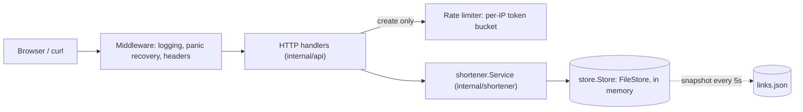
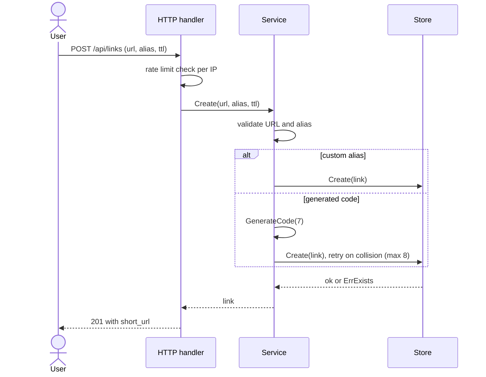
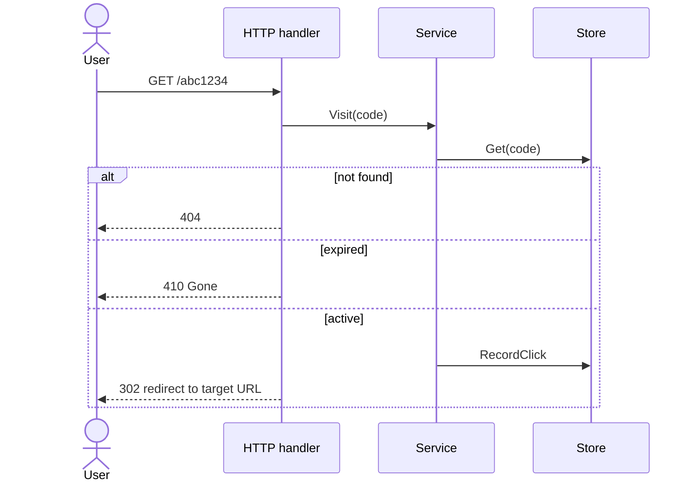
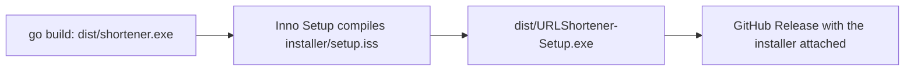
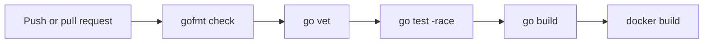

# URL Shortener


A fast, self-hosted URL shortener written in Go using only the standard library. It has a JSON API, a small web UI, per-IP rate limiting, link expiry, click statistics, a Docker image and a Windows installer.

<!-- Add a screenshot of the web UI at docs/screenshot.png, then uncomment the next line. -->
<!--  -->

## Features

- Shorten any http/https URL into a random 7-character code
- Custom aliases (`/my-link`) and optional expiry (1 hour up to 10 years)
- Click counting and last-access time per link
- Expired links return `410 Gone`, unknown links return `404`
- Per-IP token-bucket rate limiting on link creation
- API-key protected deletion
- Safe by default: only http/https targets, no credentials in URLs, no links pointing back at the shortener itself
- Data survives restarts (atomic JSON snapshots, flushed on shutdown)
- Zero third-party dependencies and a single static binary
- Graceful shutdown, structured logging and panic recovery

## How it works

### Architecture

Every request passes through the middleware, then a handler, then the service, which is the only layer that talks to storage.



### Creating a link



### Following a short link



`HEAD` requests use `Peek` instead of `Visit`, so link previews and health probes do not inflate click counts.

## Install on Windows

1. Open the [Releases page](https://github.com/2CHILON/urlshortener.go/releases) and download `URLShortener-Setup.exe` from the latest release.
2. Run it. Windows may show "Windows protected your PC" because the installer is not code-signed: click **More info**, then **Run anyway**.
3. Launch **URL Shortener** from the Start menu. A console window opens (this is the server) and your browser goes to <http://localhost:8080>.

Closing the console window stops the server. Your links are stored in `%LOCALAPPDATA%\URLShortener\links.json` and are kept when you uninstall. To uninstall, use **Settings > Apps > Installed apps**.

## Run from source

Requires the Go version listed in `urlshortener/go.mod`.

```powershell
git clone https://github.com/2CHILON/urlshortener.go.git
cd YOUR_REPO/urlshortener
go run ./cmd/server
```

Then open <http://localhost:8080>. The Go project lives in the `urlshortener` subfolder of this repository, so run Go commands from there.

## API

| Method   | Path                | Description                                                                                                   |
| -------- | ------------------- | ------------------------------------------------------------------------------------------------------------- |
| `POST`   | `/api/links`        | Create a link. Body: `{"url": "...", "alias": "optional", "ttl_seconds": 0}`. Returns `201`.                  |
| `GET`    | `/{code}`           | Redirect to the target (`302` by default). `404` if unknown, `410` if expired.                                |
| `GET`    | `/api/links/{code}` | Stats: target, clicks, last access, expiry.                                                                   |
| `DELETE` | `/api/links/{code}` | Delete a link. Requires `X-API-Key` or `Authorization: Bearer`. Returns `403` if `API_KEY` is not configured. |
| `GET`    | `/healthz`          | Liveness check.                                                                                               |

PowerShell:

```powershell
Invoke-RestMethod -Method Post http://localhost:8080/api/links `
  -ContentType application/json `
  -Body '{"url":"https://go.dev/doc","alias":"godoc","ttl_seconds":3600}'
```

curl:

```bash
curl -X POST http://localhost:8080/api/links \
  -H "Content-Type: application/json" \
  -d '{"url":"https://go.dev/doc"}'
```

Errors are JSON: `{"error": "message"}`. Status codes: `400` invalid input, `401` bad API key, `409` alias taken, `429` rate limited (with a `Retry-After` header).

## Configuration

All settings are environment variables.

| Variable             | Default                 | Description                                                                   |
| -------------------- | ----------------------- | ----------------------------------------------------------------------------- |
| `ADDR`               | `:8080`                 | Listen address                                                                |
| `BASE_URL`           | `http://localhost:8080` | Public origin used when building short links                                  |
| `DATA_FILE`          | `data/links.json`       | Snapshot file. Empty means in-memory only                                     |
| `API_KEY`            | _(empty)_               | Enables `DELETE`. Unset means deletion is disabled                            |
| `CODE_LENGTH`        | `7`                     | Length of generated codes (4 to 32)                                           |
| `REDIRECT_STATUS`    | `302`                   | `301`, `302`, `307` or `308`                                                  |
| `RATE_LIMIT_PER_MIN` | `30`                    | Link creations per minute per IP. `0` disables limiting                       |
| `RATE_BURST`         | `10`                    | Rate-limiter burst size                                                       |
| `TRUST_PROXY`        | `false`                 | Read client IP from `X-Forwarded-For`. Enable only behind a proxy you control |
| `FLUSH_INTERVAL`     | `5s`                    | How often changes are written to disk                                         |

Example:

```powershell
$env:API_KEY = "change-me"
$env:BASE_URL = "https://sho.example.com"
go run ./cmd/server
```

## Project layout

```
.github/workflows/ci.yml            CI pipeline
urlshortener/
  cmd/server/main.go                entry point, wiring, graceful shutdown, expiry janitor
  internal/config/                  environment configuration and validation
  internal/shortener/               business logic: code generation, validation, service
  internal/store/                   Store interface and file-backed implementation
  internal/api/                     HTTP routes, middleware, rate limiter, embedded web UI
  installer/                        Inno Setup script and Windows launcher
  Dockerfile                        multi-stage container build
```

### Storage

The default store keeps everything in memory and writes snapshots to a JSON file using write-to-temp-then-rename, so a crash cannot leave a half-written file. It is designed for a **single running instance**. To run several instances or use a database, implement the five-method `store.Store` interface (for example for PostgreSQL, Redis or DynamoDB) and change one line in `cmd/server/main.go`.

## Tests

Run these from the `urlshortener` folder:

```powershell
go test ./...          # run everything
go test -v ./...       # verbose
go test -count=1 ./... # bypass the test cache
```

The tests cover code generation, URL and alias validation, expiry with a fake clock, persistence across restarts, and the full HTTP flow including rate limiting and API-key auth.

## Build

From the `urlshortener` folder:

```powershell
# Windows executable
go build -ldflags="-s -w" -o dist\shortener.exe ./cmd/server
```

Cross-compile for other systems:

```powershell
$env:CGO_ENABLED = "0"
$env:GOOS="linux";  $env:GOARCH="amd64"; go build -o dist/shortener-linux ./cmd/server
$env:GOOS="darwin"; $env:GOARCH="arm64"; go build -o dist/shortener-mac-arm ./cmd/server
Remove-Item Env:GOOS, Env:GOARCH
```

### Windows installer and releases



1. Build `dist\shortener.exe` as above.
2. Install [Inno Setup](https://jrsoftware.org/isinfo.php), open `installer\setup.iss` and press **Ctrl+F9**.
3. The installer is written to `dist\URLShortener-Setup.exe`.
4. Attach it to a new release on GitHub (web UI, or `gh release create`).

### Docker

```powershell
cd urlshortener
docker build -t urlshortener .
docker run -p 8080:8080 -v ${PWD}/data:/data -e BASE_URL=http://localhost:8080 urlshortener
```

The image is a multi-stage build that ends in a small distroless image running as a non-root user.

## Continuous integration

Every push to `main` and every pull request runs the workflow in `.github/workflows/ci.yml`:



## Roadmap

- Database-backed store (PostgreSQL or DynamoDB) for multi-instance deployments
- Automated multi-platform releases with GoReleaser and GitHub Actions
- Code-signed Windows installer
- QR code endpoint
- Deployment to AWS (App Runner or EC2)

## License

Released under the MIT License. See [LICENSE](LICENSE).
